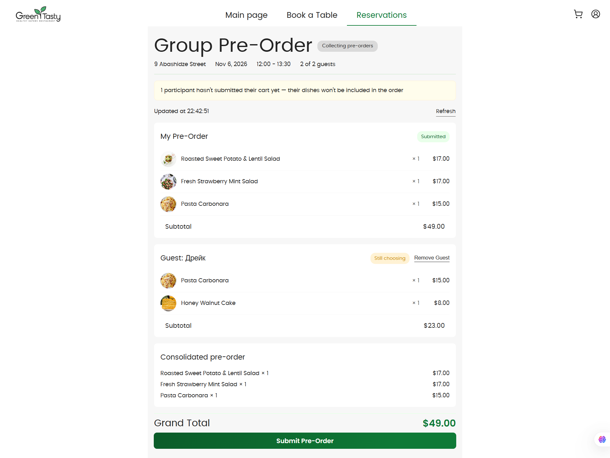
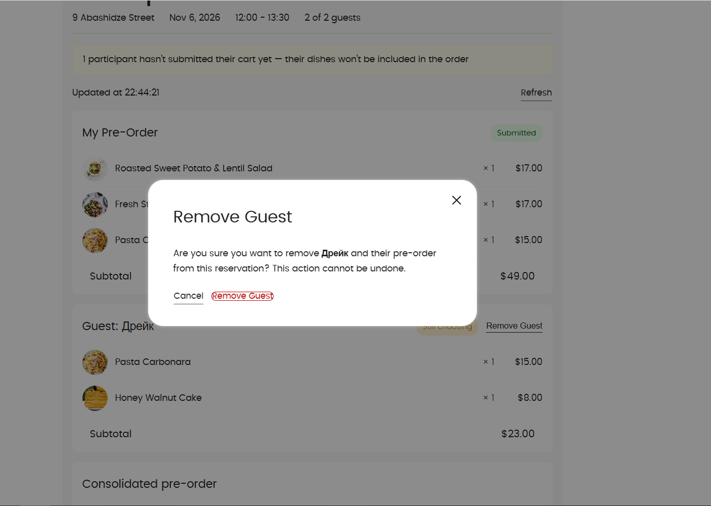
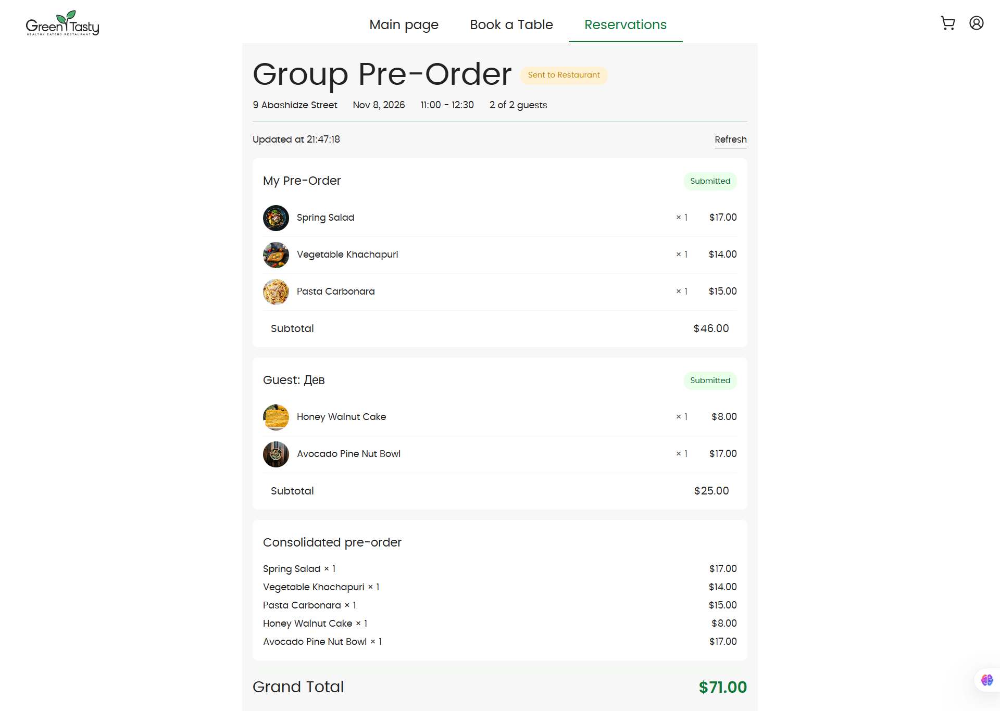
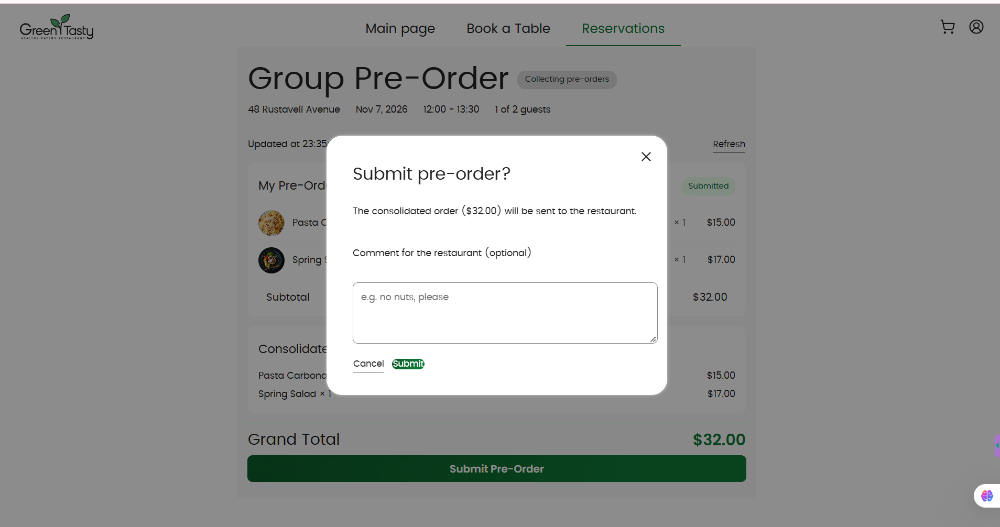
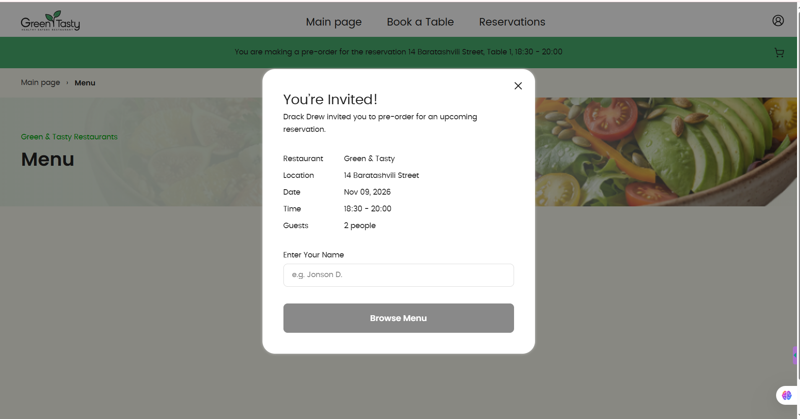
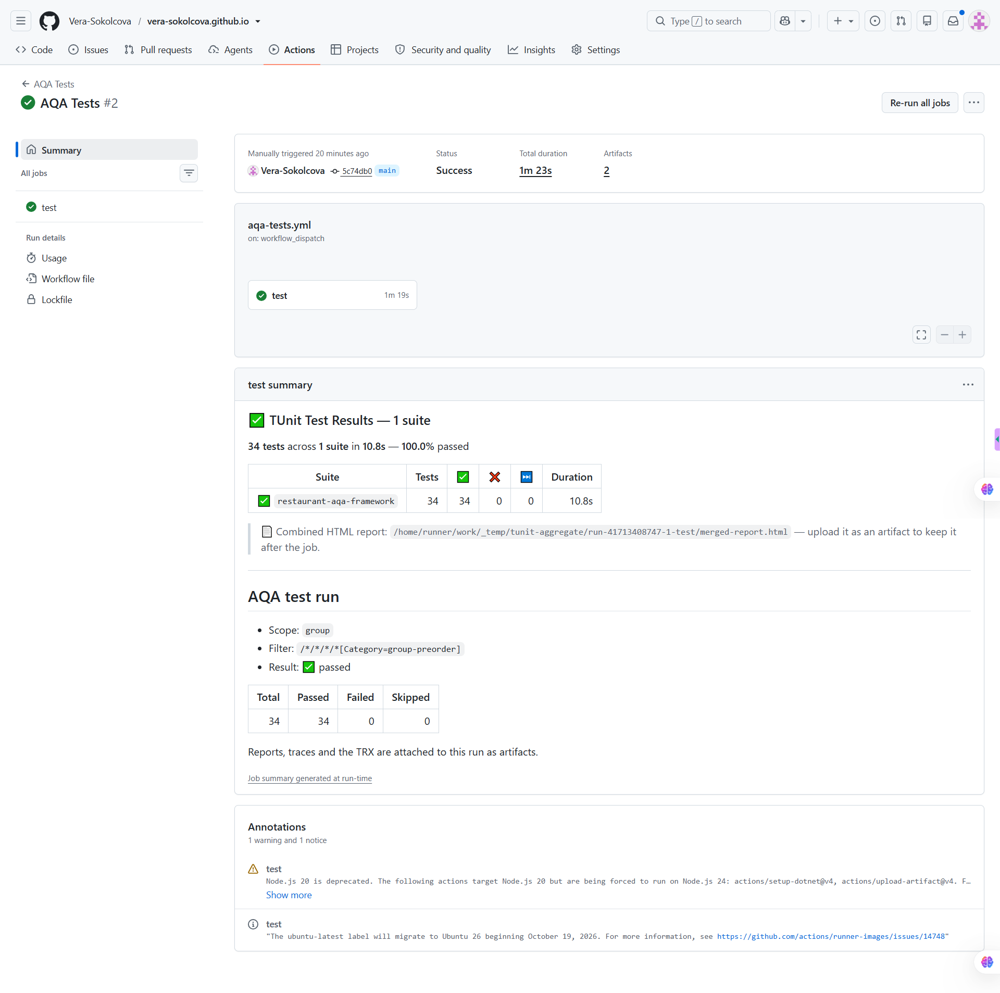

# Green & Tasty — ресторанний застосунок із груповим pre-order

Застосунок для бронювання столиків у мережі ресторанів «Green & Tasty». Головна функція цього репозиторію —
**груповий pre-order**: власник бронювання запрошує гостей, кожен гість збирає власне замовлення, а власник
бачить усе разом, може видалити учасника і підтвердити один консолідований pre-order, який іде в ресторан.

| | |
|---|---|
| Сайт | https://vera-sokolcova.github.io |
| API | https://restaurant-api-srom.onrender.com |
| Хостинг | фронтенд — GitHub Pages, бекенд — Render (безкоштовний план) |

> Безкоштовний бекенд «засинає» після ~15 хвилин простою, перший запит може тривати до хвилини.
> Дані зберігаються в пам'яті й скидаються при перезапуску: сервіс заново створює демо-дані.

Демо-облікові записи: клієнт `owner@example.com` / `Owner123!`, офіціант `waiter@example.com` / `Waiter123!`.

## Що зроблено

**Backend (.NET 10)**
- `GET /guest/groups/{id}/sessions` — власник бачить учасників, їхні страви, суми по кожному і загальну (L1);
- `GET /reservations/{id}/guest-session-id` — власна сесія власника в групі;
- `POST /group-reservations/{id}/submit` — підтвердження консолідованого pre-order, замовлення отримує статус
  `SubmittedByCustomer`, група — `Submitted` (L2);
- `DELETE /guest/groups/{id}/sessions/{sessionId}` — видалення учасника з перерахунком суми (L3);
- **додатково:** до `POST /group-reservations/{id}/submit` можна передати необов'язковий `comment` (до 300 символів) —
  побажання для ресторану («без горіхів»). Коментар зберігається в замовленні й повертається в `GET /orders/{reservationId}`,
  тож його бачить офіціант; задовгий коментар відхиляється з `400`;
- юніт-тести сервісів, CI збирає і тестує бекенд (`backend-ci.yml`).

**Frontend (Angular)** — сторінка групового замовлення власника (`/reservations/{id}/group-order`):
учасники з їхніми стравами й сумами, відмітка «Submitted / Still choosing», кнопка **Remove Guest** з підтвердженням,
консолідований список, **Submit Pre-Order**, статус «Collecting pre-orders» / «Sent to Restaurant».
**Коментар до замовлення:** у діалозі підтвердження є поле «Comment for the restaurant (optional)» (до 300 символів);
офіціант бачить цей коментар на сторінці pre-order («Customer's comment: …»).

**Розгортання без AWS** — бекенд працює в режимі `LOCAL_MODE` (дані в пам'яті, власна авторизація на JWT),
фронтенд публікується на GitHub Pages. Опис: [DEPLOY-FREE.md](DEPLOY-FREE.md). Початкова AWS-інструкція збережена
в [DEPLOY-AWS.md](DEPLOY-AWS.md).

**Автотести (AQA, напрям 1 — груповий pre-order)** — [aqa/restaurant-aqa-framework](aqa/restaurant-aqa-framework/README.md):
C# + Reqnroll (Gherkin) + TUnit + Playwright, патерн Screenplay. 36 сценаріїв: API (авторизація, валідація, підготовка
даних) і UI (основні сценарії власника). Кожен тест створює власні дані й прибирає їх після себе.
Запускаються в GitHub Actions (`AQA Tests`), звіти й трейси зберігаються як артефакти.

## Репозиторій

| Папка | Вміст |
|---|---|
| `backend/` | API на .NET 10, режим `LOCAL_MODE`, юніт-тести |
| `frontend/` | Angular-застосунок |
| `aqa/restaurant-aqa-framework/` | автотести |
| `.github/workflows/` | CI: `backend-ci`, `pr`, `deploy-pages`, `aqa-quality`, `aqa-tests` |
| `infra/` | початкова AWS-інфраструктура (Terraform), у цьому розгортанні не використовується |
| `docs/screenshots/` | скріншоти для опису |

## Скріншоти

### Сторінка групового замовлення власника


### Видалення гостя


### Підтвердження pre-order


### Коментар до замовлення для ресторану


### Сторінка гостя


### Автотести в CI


## Запуск автотестів

Потрібні змінні `UI_URL`, `API_URL`, `WAITER_USERNAME`, `WAITER_PASSWORD`, `TESTTABLE_ID`
(детально — у [README фреймворку](aqa/restaurant-aqa-framework/README.md)).

```bash
cd aqa/restaurant-aqa-framework
cp .env.example .env     # заповніть своїми значеннями
dotnet build
dotnet run --no-build -- --treenode-filter "/*/*/*/*[Category=group-preorder]"
```

У CI: Actions → **AQA Tests** → **Run workflow**. Змінні й секрети задаються в Settings → Secrets and variables → Actions
(`AQA_UI_URL`, `AQA_API_URL`, `AQA_TESTTABLE_ID`, `AQA_WAITER_USERNAME`, `AQA_WAITER_PASSWORD`).
